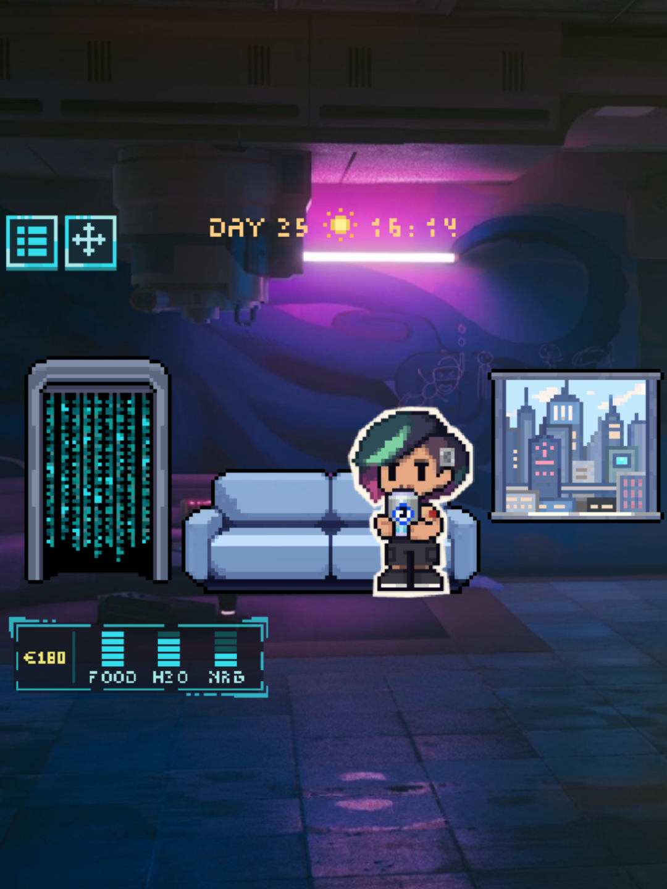
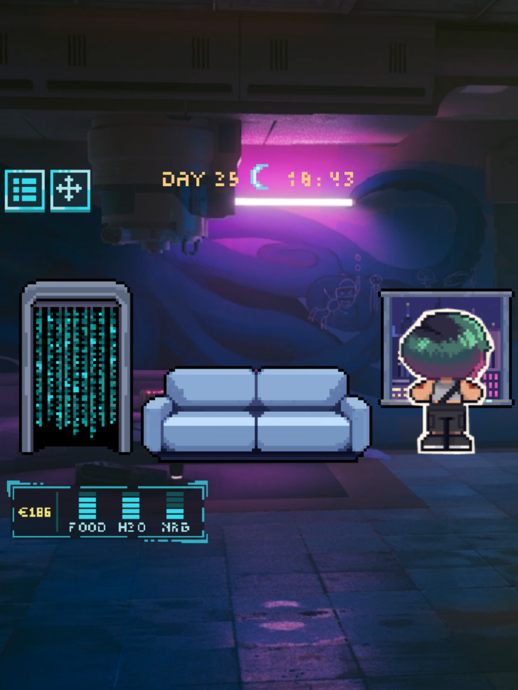
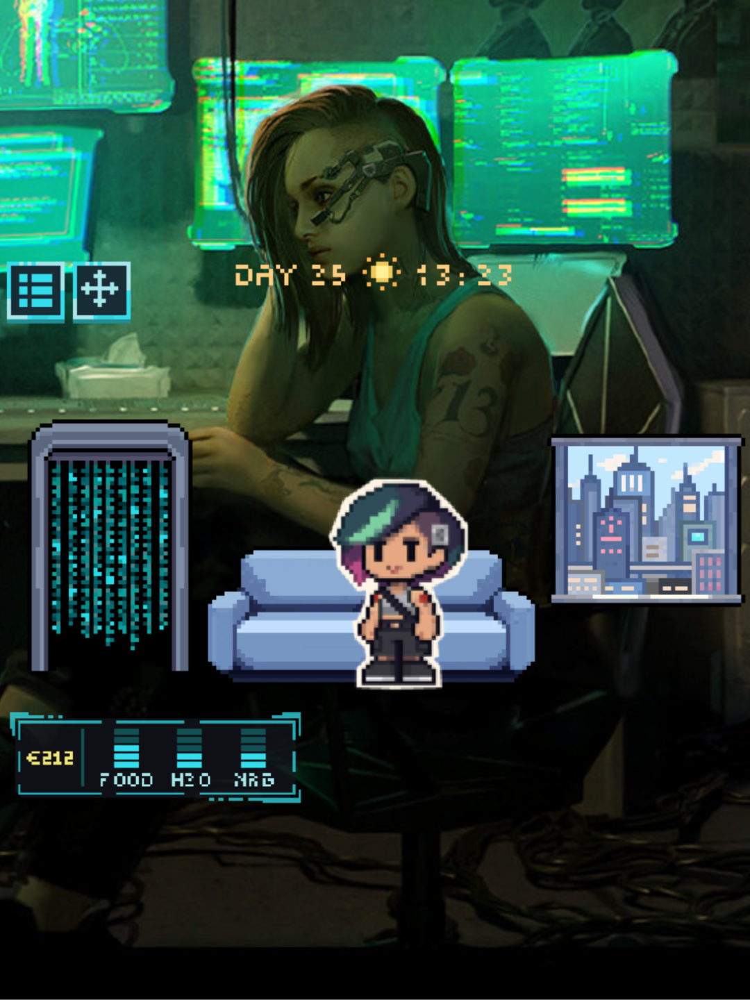
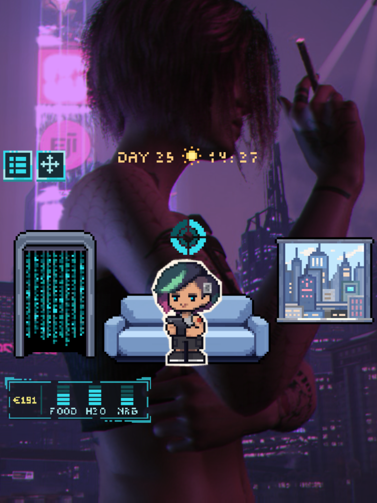
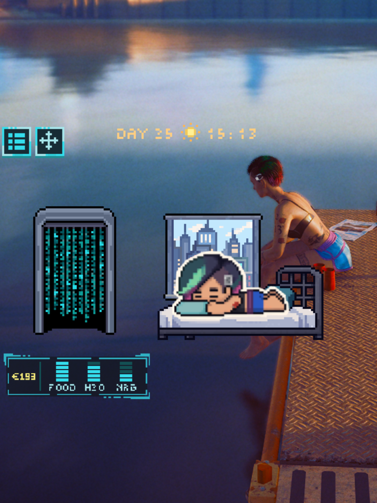
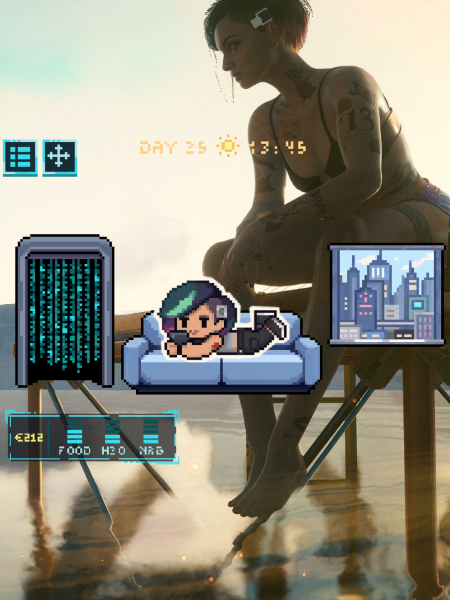

# Judy Desktop Pet

An unofficial, fan-made pixel-art desktop pet of **Judy Alvarez** for Windows.
It brings Judy and her Charter St apartment to your desktop. There isn't a ton of content yet: Judy wanders around, eats, drinks, sleeps and moves between rooms, and you keep her fed, hydrated and rested. Or just leave her be, she's perfectly capable of looking after herself! ;)

  
  
  

<b>More screenshots / 更多截图</b>

 

  
  
  

**Current version: v0.1.0 Beta** (first public release). This is also a birthday present for Judy. Happy birthday, Judy! 🎂

Made by **ShanE-2077** (山阿ShanE)

[中文说明在下方](#中文说明)

## Download & run

1. Go to the **[Releases](../../releases)** page (the download page, also linked on the right side of this repo) and download `JudyDesktopPet-v0.1.0-beta-windows-x64.zip`.
2. Unzip it anywhere.
3. Double-click `JudyDesktopPet.exe`. No installation and no internet connection needed.

Requirements: Windows 10 / 11, 64-bit.

> If Windows shows "Windows protected your PC", click **More info → Run anyway**.

## How it works

- **Stats**: Hunger, Thirst and Energy (FOOD / H2O / NRG on the status bar) go down over time. Hover a meter to see its full name and exact value.
- **Eddies**: you start with €100 and earn €1 every 30 seconds while the pet is running.
- **Shop**: click the money on the status bar to open the shop. Click an item to select it, then hit **BUY**. Pizza €15, NiCola €8.
- **Stash**: click any stat on the status bar to open your stash. Click a snack or drink, or drag it onto Judy to feed her.
- **Right-click Judy** for her action menu, then **ACTIONS** to tell her what to do: Eat, Drink, Sleep, Change room, or Stop (whatever she's doing).
- **Judy looks after herself too**: she goes to bed when she's tired or when it's bedtime, eats and drinks when she's hungry or thirsty, and if the stash is empty she'll order something, as long as she can afford it.
- **Menu** (top-left icon): Hide UI, Pause, Journal, Settings, Quit.
- **Move Pet** (top-left icon): drag to move the whole pet window.
- **UI hidden?** Right-click Judy → Restore UI.
- **Paused?** Right-click anywhere on the pet window to resume.
- **Journal**: a log of everything Judy's been up to (keeps the latest 500 entries).
- **Settings**: volume, panel opacity, window size (three steps), always on top, reset.
- **Time speed**: 1 day on Judy's clock = 30 minutes of real time.

Judy Desktop Pet saves automatically and asks whether to save when you quit.
Save file: `%APPDATA%\JudyDesktopPet-Lite\save.json` (paste `%APPDATA%\JudyDesktopPet-Lite` into the File Explorer address bar to jump straight there).

**Uninstall**: delete the pet's folder, and the save folder above if you want to remove your progress.

## Credits

- Design, character art and pixel art: **ShanE-2077** (山阿ShanE)
- UI art and the Cyberphont font: **Finnmercury**, "Ultimate Pixel Sci-Fi UI" ([itch.io](https://finnmercury.itch.io/sci-fi-ui-elements)), used under a purchased license and modified for this project
- Sound effects: **Kenney** ([kenney.nl](https://kenney.nl)), CC0
- Made with the [Godot Engine](https://godotengine.org) (MIT license)

See [THIRD_PARTY_NOTICES.md](THIRD_PARTY_NOTICES.md) for details.

## Disclaimer

This is an unofficial, non-commercial fan project. Judy Alvarez, Cyberpunk 2077 and related names and world elements belong to CD PROJEKT RED. This project is not affiliated with or endorsed by CD PROJEKT RED. No files from Cyberpunk 2077 were extracted or used.

---

## 中文说明

**朱迪桌宠**是一个非官方的同人像素桌宠（Windows）。把朱迪和她在宪章街的公寓搬到你的桌面上。目前内容不多：朱迪会走来走去、吃喝、睡觉、在客厅和卧室之间来回移动，你得让她吃饱喝足睡好，当然单纯放置的话她也能照顾好自己，无需你额外操心。;)

**当前版本：v0.1.0 Beta**（首发测试版本）。这也是送给朱迪的生日礼物。朱迪，生日快乐！🎂

作者：**山阿ShanE**（GitHub：ShanE-2077）

### 下载与运行

1. 打开 **[Releases](../../releases)** 下载页（仓库页面右侧也有入口），下载 `JudyDesktopPet-v0.1.0-beta-windows-x64.zip`。
2. 解压到任意位置。
3. 双击 `JudyDesktopPet.exe`。不用安装，也不用联网。

系统要求：Windows 10 / 11，64 位。

> Windows 可能弹出「Windows 已保护你的电脑」。点 **更多信息 → 仍要运行** 就好。

### 使用说明

- **状态**：饱食（FOOD/HUNGER）、水分（H2O/THIRST）、精力（NRG/ENERGY）会随时间下降。鼠标停在格子上可以看到完整名称和具体数值。
- **钱（eddies）**：初始 €100，桌宠运行时每 30 秒 +€1。
- **商城**：点状态栏上的钱可以打开商城。点物品选中，再点 **BUY** 购买。披萨 €15，小可可乐 €8。
- **背包**：点状态栏上的任意状态均可打开背包。单击食物或饮料或者拖到朱迪身上都可以投喂她。
- **右键朱迪**会弹出行为选单 → **ACTIONS** 可以发出指令：吃东西、喝饮品、睡觉、换房间、停止当前行为。
- **朱迪也会照顾自己**：困了或者到点了会自己去睡觉，饿了会自己吃喝，如果正好没有食物饮料，钱够的话她会自己下单。
- **菜单**（左上角图标）：隐藏界面、暂停、日志、设置、退出。
- **移动**（左上角图标）：按住拖动整个桌宠窗口。
- **隐藏界面后**：右键朱迪 → Restore UI 恢复。
- **暂停后**：在桌宠上任意位置右键即可继续。
- **日志**：记录朱迪的所有历史行为（保留最近 500 条）。
- **设置**：音量、面板透明度、窗口大小（三档）、窗口置顶、恢复默认。
- **时间流速**：桌宠里的一天等于现实中的 30 分钟。

桌宠会自动保存，退出时会询问是否保存。
存档位置：`%APPDATA%\JudyDesktopPet-Lite\save.json`（把 `%APPDATA%\JudyDesktopPet-Lite` 复制到文件夹的地址栏里回车，就能直接打开存档文件夹）。

**卸载**：删除桌宠文件夹即可。如果连进度也要删，再删掉上面的存档文件夹。

### 致谢

- 设计、角色与像素美术：**山阿ShanE**（ShanE-2077）
- 界面素材与 Cyberphont 字体：**Finnmercury**「Ultimate Pixel Sci-Fi UI」（[itch.io](https://finnmercury.itch.io/sci-fi-ui-elements)），已购买授权使用，本项目有做修改
- 音效：**Kenney**（[kenney.nl](https://kenney.nl)），CC0
- 引擎：[Godot](https://godotengine.org)（MIT 许可）

详见 [THIRD_PARTY_NOTICES.md](THIRD_PARTY_NOTICES.md)。

### 声明

本项目为非官方、非商业的同人作品。朱迪·阿尔瓦雷斯（Judy Alvarez）、《赛博朋克 2077》及相关名称和世界观元素归 CD PROJEKT RED 所有。本项目与 CD PROJEKT RED 官方无关，未提取或使用任何《赛博朋克 2077》的文件。
